# Classic Fizz Pose Workshop

  

A pose set derived from the unmodified original native Classic Fizz study, vendored in `source/classic-fizz-original.json`. The initial polished version is preserved in the first Git commit. The original files are preserved. Run `bun run dev` and open the printed local URL for the gallery and pixel editor. `standalone-preview.html` is the generated read-only gallery that also works directly from disk. The preview supports pause, scale, playback speed and side-view mirroring, and initially pauses when reduced motion is requested.

## Pixel editor

Install dependencies with `bun install`, then run `bun run dev`. The development server listens on `0.0.0.0:5173`, so the lab is available at `http://localhost:5173/` on this machine and at `http://<this-machine-LAN-IP>:5173/` from another device on the same network. The editor supports palette drawing, erasing, colour picking, continuous pointer strokes, undo/redo, per-frame reset and a native-size preview. Click a static gallery pose or use the frame selector to edit it. Gallery and animation previews update live.

Drafts are stored in this browser for this local address. **Save to project** writes `edits.json` and regenerates PNG, SVG, GIF, sprite-sheet and standalone preview exports. Generation and saving run entirely in Bun and TypeScript. Saving is explicit; browser drafts alone do not change repository files. Original source art stays untouched. JSON export/import provides portable backups; PNG export downloads the selected frame at native resolution.

`bun run generate` rebuilds assets with saved edits applied. `bun run test` checks pixel history and frame validation. `bun run build` creates `dist/` with the editor and image exports; `bun run preview` serves that build. The built editor supports browser drafts and JSON/PNG export; saving to project requires `bun run dev`.

The app entry is `index.html`; `preview.html` redirects to the app. `src/` contains the gallery, editor, styles and edit validation. `vite.config.ts` handles the development save endpoint and packages the image exports for builds. Frame overrides in `edits.json` take precedence over the authored grids in `source/poses.json`; per-frame reset restores the project version loaded by the page.

## Game palette

The editable sprites use exactly the game's sixteen EGA colours plus transparent (`.`). `source/game-palette.json` mirrors `packages/engine/src/palette.ts` from the game repository. The untouched original reference keeps its original colours. Imports and older browser drafts are converted to game codes before validation. Saved edits and all generated sprite exports use the game palette.

| Code | Colour | Hex |
|---|---|---|
| `.` | Transparent | None |
| `k` | Black | `#000000` |
| `B` | Blue | `#0000aa` |
| `G` | Green | `#00aa00` |
| `C` | Cyan | `#00aaaa` |
| `R` | Dark red | `#aa0000` |
| `M` | Magenta | `#aa00aa` |
| `N` | Brown | `#aa5500` |
| `L` | Light grey | `#aaaaaa` |
| `D` | Dark grey | `#555555` |
| `b` | Bright blue | `#5555ff` |
| `g` | Bright green | `#55ff55` |
| `c` | Bright cyan | `#55ffff` |
| `r` | Bright red | `#ff5555` |
| `m` | Bright magenta | `#ff55ff` |
| `y` | Yellow | `#ffff55` |
| `W` | White | `#ffffff` |

Legacy codes map as follows: `K` → `k`, `Q` → `G`, `h` → `W`, `V` → `N`, `O` → `N`, `s` → `b`, and `A` → `B`. Other codes remain unchanged. Skin maps to white to match the game's Ben, muted denim to bright blue, and orange/tan to brown. The mapping in `source/colour-map.json` is intentional rather than a nearest-RGB conversion.

## Artwork

The three-quarter side-view keeps the original 16 × 32 standing proportions on a transparent 24 × 44 canvas with room for raised arms, a blaster and a pogo spring. The standing grid retains the original design, translated by (4, 4) into the shared canvas, with the original foreground shoe mirrored to face left and its toe extended one pixel left without moving the ankle. The foreground heel extends one pixel right through its red upper, white sole and grey underside, with its outer black outline moved to match. The matching rear shoe is raised two pixels for perspective, with its toe extended one pixel left while its ankle stays in place. A stepped black outline separates the foreground toe from the raised rear shoe and continues upward towards the ankle. The original yellow belt dot is retained; the front trouser leg and shoe mask the overlapping rear shoe pixels. The untouched original remains in `source/classic-fizz-original.json` and the comparison image. Action frames use its original head and torso, including the flat helmet, fragmented racing stripe and grey rim. Newly drawn action limbs use cyan denim seams, white gloves and red shoes with white toe caps, white soles and grey undersides. The lab retains the game’s action pose studies, with a separate six-frame right-facing run built from the current Ben artwork. `ben_walkRight1` through `ben_walkRight6` replace the retired `ben_run1` through `ben_run4` grids and exports. They show a true side profile with one visible blue eye, a forward helmet brim, alternating arm and leg swings, cyan denim seams and the purple Stunner clipped to the belt and angled with the near thigh. The torso and head lean forward for running, and the short sleeves meet the exposed forearms without an interior black cuff seam. The three-quarter idle stands remain separate. Climbing shows the back of the helmet and shirt. `ben_standRight` mirrors the current left-facing standing pose and adds a compact purple Fizz Stunner below the near hand, attached to the belt with a dark clip. The right-facing version is separate so its visible equipment can differ from the left-facing pose. `ben_standFront` is a new camera-facing pose with a narrower head, centred helmet stripe, symmetric eyes, softly joined short sleeves, longer arms, a single black trouser seam and front-facing shoes and a small Stunner at Ben’s right hip (the viewer’s left). The game currently has no dedicated front-facing stand; these poses are lab assets. `ben_frontLookUp` tips the face towards the sky. `ben_frontBendHalf` lowers the gaze while bending partway forward; `ben_frontBendFull` presents the helmet crown towards the camera. Both bending frames spread the arms and hands outward for balance. All three preserve the saved front-facing stand’s legs, shoes and hip equipment at the same pixel positions (rows 24–43).

The overworld is a separate top-down design on a 24 × 24 canvas with eight headings (N, NE, E, SE, S, SW, W, NW). Each heading has two walking frames. The helmet stripe, grey rim, brim and partial face indicate the heading; feet and hands alternate. This replaces the current head-and-shoulders interpretation for this study.

## Files

- `frames/`: all 137 individual transparent PNGs and editable pixel-rectangle SVGs.
- `animations/`: fifteen action sequences and eight overworld walk loops, each as an animated SVG and transparent GIF.
- `assets.json`: palette, every editable pixel grid, per-frame timing and sprite-sheet rectangles.
- `sheets/ben-poses.png`: transparent sprite sheet in automatically sized 40 × 72 cells; use the per-frame rectangles in `assets.json` for native dimensions.
- `scripts/build-assets.ts`: Bun/TypeScript asset generator. Run `bun run generate` to regenerate exports.
- `source/poses.json`: editable source pixel grids and animation timing, preserved independently of generated output.
- `templates/`: README and standalone gallery templates.
- `original-study.png`: a copy of the original native study at 6× for comparison.

## Animation and integration notes

The right-facing run uses twelve phases at 50 ms each (600 ms per loop): near contact, roll-through, push-off, toe-off, flight towards far contact and the far leg's reach, then the same six phases on the far leg. Each stride repeats the other with the legs swapped. Arms swing opposite their own legs with bent elbows. Shoes lift their toes and compress on landing, settle flat, then bend at the grounded forefoot through toe-off; both feet clear the ground in the two flight poses. Body bob is one pixel down, neutral, one pixel up for each step. Head and shoulder turns follow smooth periodic motion towards and away from the camera. The running eye anchors a two-pixel horizontal path in canvas space, including body motion. The mouth follows it, and the nose projection tucks into the head at either camera-facing turn. The ear, cheeks and jaw stay anchored; a slight camera-facing turn reveals a second mouth pixel. The rig viewer includes a twelve-frame face sequence and measured coordinate table. The near and far shoulders counter-rotate by one pixel, and chest shading and the partial emblem follow that torso turn. The Stunner rotates with the near thigh around its belt attachment. Pogo uses six phases at 150 ms each: compression, launch, rise, apex, fall and landing. The tip stays grounded through compression and launch, lifts during flight, then lands; the grips and pegs carry the hands and feet throughout. Climbing uses six alternating arm/leg poses at 180 ms each. The pull-up preview shows grip, haul, push and a resting pose; the Fizz Stunner preview uses six phases at 100 ms each: aim, discharge, recoil, recover, settle and ready. The gun is drawn in the hands, with a brief cyan/white/yellow muzzle flash, while the feet stay planted. These are art preview timings, not changes to deterministic simulation timing. Animated SVGs honour reduced-motion preferences; GIF players control their own playback.

This is an external art workshop, not a game asset replacement. The taller side-view and new top-down dimensions differ from the current 16 × 24 side-view, 16 × 32 pogo and 16 × 16 overworld sprites. Integration would require deliberate atlas, draw-size and anchor review. The user interface, simulation and repository assets are unchanged.

## Continuous rig and reusable animation tools

[Rig guide](docs/RIG.md) describes the saved rig, skin bindings, sampler, exporter and how to reuse them for another character. `source/ben-side-rig.json` defines bone lengths and motion; `source/ben-side-skin.json` defines the pixel patches. `src/rig/` contains the reusable continuous solver and viewer. `scripts/draw-run-cycle.ts` samples twelve poses for each direction into the editable grids and saves the reusable exports in `rig/ben-running/` and `rig/ben-running-left/`. Run `bun run draw:run`, then `bun run generate`, to redraw Ben from the rig. Ordinary generation preserves manual editor overrides.

| Frame | Legs and contact | Arms | Body |
|---|---|---|---|
| 1. Near contact | Near foot lands; far heel is tucked | Near arm back, far arm forward. | Low contact |
| 2. Near push-off | Near heel lifts into toe-off; far knee drives forward | Arms reverse. | Rising push-off |
| 3. Flight · far leg leads | Both feet airborne; far leg reaches ahead | Near arm forward, far arm back. | High flight |
| 4. Far contact | Far foot lands; near heel is tucked | Near arm forward, far arm back. | Low contact |
| 5. Far push-off | Far heel lifts into toe-off; near knee drives forward | Arms reverse. | Rising push-off |
| 6. Flight · near leg leads | Both feet airborne; near leg reaches ahead | Near arm back, far arm forward. | High flight |

The run checks measure fixed bone lengths and consistent elbow bends throughout the continuous cycle, grounded toe motion, flight clearance, loop closure and the six rendered contacts. A second character configuration verifies reusable exports at different proportions and sample counts. Browser verification checks playback order and compares every decoded GIF frame with its PNG export.

Choose **Run**, **Pogo** or **Fizz Stunner** in the rig preview's **Action** selector. Each action has continuous and six-sample views, joint overlays, facial measurements and frame stepping. The twelve new action frames are also available in the pixel editor. Pogo uses a 24 × 52 canvas; firing uses 32 × 44 to leave room for the muzzle flash.

Run `bun run draw:actions` followed by `bun run generate` to rebuild both action cycles. Their settings live in `source/ben-pogo-rig.json` and `source/ben-fire-rig.json`; reusable exports are saved in `rig/ben-pogo/` and `rig/ben-firing/`. All three motions share `source/ben-side-skin.json`. Redrawing an action replaces its saved editor grids, so commit or export manual adjustments before redrawing. Ordinary generation preserves those adjustments.

## Expressive action and idle rigs

The rig preview includes **Ladder climb**, **Jump right/left**, **Fall right/left**, **Dramatic death**, **Ledge pull left/right**, **Whistling left/right** and **Seated phone idle** alongside Run, Pogo and Fizz Stunner. Their poses are available in the frame selector and in ordered strips: the jump and the fall have six each in both directions and each ledge pull eleven (the left sets keep the Fizz Stunner on his far, right hip rather than mirroring it), the ladder climb eight hand over hand, the death seven and the phone idle nine, with in-betweens sampled between the keys and per-frame holds. Run `bun run draw:performances`, then `bun run generate`, to rebuild them from their saved JSON rigs; manual editor overrides are kept unless `--replace-edits` is passed. See [the rig guide](docs/RIG.md) for editable goals, exports and playback details.

Every action keeps playing in the rig inspector and the **Action loops** gallery, each sprite held for its own frame time: the death, ledge pulls and phone idle hold their final pose briefly and then replay, while the jump loops straight back into its crouch. **Play rig** and **Pause rig** start and stop the inspector; **Restart animations** replays the gallery actions. Climbing, falling and whistling loop. The death study clutches the belly, thrusts both soles towards the camera and changes comic expressions while the head wobbles from side to side on held beats before a final topple. The fall braces for impact, with the arms guarding the chest, the knees bent and the feet ready to land, in both directions; its shirt hem and sleeves flutter in the rushing air (see the cloth parts in the rig guide). The seated phone idle faces the camera with crossed legs and a dark back case facing the player.

**Phone-screen lighting note:** use the screen as a small dynamic light on Ben’s face and hands in the game, fading it with screen visibility. The note is saved with the phone rig; sprite exports keep the game’s sixteen-colour palette, and engine lighting is not implemented in this workshop.

Whistling has separate left- and right-facing sets derived directly from the saved standing sprites, with the Fizz Stunner on his right hip only. Ben bobs on two beats, sways and nods, lifts his near toe before each beat and blinks, while his lower lip pulses grey to red and back as each note floats off his lips. The jump spreads its legs and angles its feet in flight, returning to flat soles at landing. Both ledge directions have separate editable frames and saved exports from one shared rig. The ladder climb grips each rung and holds it while the body rises, then reaches the other hand two rungs up, with the Stunner on his right hip seen from behind.

The **Look up & down** loop uses the saved front-facing look and bend poses: 800 ms looking up, 400 ms per downward pose and 200 ms per neutral transition. It reuses the existing artwork.

## Standing 360° turntable

The **Standing 360°** section has independent playback, speed, stepping, an angle slider, 24 clickable angle stops and an optional body-rig overlay. **Edit this angle** opens the selected pose in the pixel editor. The 24 frames cover 0°–345° in 15° increments at 120 ms each, with PNG/SVG frames and a looping GIF/SVG. It also works in the standalone gallery.

The right front quarter (45°) and left front quarter (315°) preserve the saved standing pixels with horizontal padding only. The front (0°) preserves the source head and torso, with one denim row inserted before the shoes to align the soles without lowering the crown. True side heads use the running design without its lean; the rear head uses the climbing skin. Missing angles use palette-indexed contour interpolation over a fixed standing rig. They are inferred views rather than additional original artwork. The Stunner follows Ben’s same anatomical right hip.

Run `bun run draw:turntable` then `bun run generate` to rebuild the study. `source/ben-turntable-rig.json` stores the standing joints and volumes; `source/ben-turntable-skin.json` stores stable reference snapshots and the side/rear head patches. Saved exports and the reference audit live in `rig/ben-turntable/`. See [the rig guide](docs/RIG.md) for the model-sheet findings and reconstruction limits.

The [source and in-between review](docs/TURNTABLE_REVIEW.md) describes the reference details, the former block-shaped shoes and the refinement. `source/ben-turntable-shoes.json` defines separate directional high-top patches: a six-pixel front width, ten-pixel full quarter/side length, ankle openings, shaped toes, heel panels, white near soles and grey raised far soles. Crown and lowest sole stay on rows 2 and 34.

`bun run turntable:render` renders the 3D Ben at every turntable angle and converts each view into a reference grid on the same canvas, in the 16 EGA colours with a black outline. In the pixel editor, tick **3D reference** on any `ben_turn*` frame to trace over the render at that angle. The renders never replace the saved frames; `source/turntable-pilot-135.json` is a hand-cleaned draft of the missing 135° key made from one. See [the render path](docs/TURNTABLE_REVIEW.md#3d-reference-renders) for the method, the pilot comparison and what the automatic output gets wrong.

## Fizz Stunner study

The **Fizz Stunner · on its own** section shows eleven editable views at enlarged and native scale, plus turnaround and discharge/recoil loops. The four-by-five holstered patch and eight-by-six held side profile are exact source artwork; opposite side views are mirrored. Front, rear and quarter views are labelled interpretations of the tiny sidearm. Every frame exports as PNG/SVG, and both loops export as GIF/SVG.

`source/fizz-stunner-study.json` records the views and provenance. Run `bun run draw:stunner` then `bun run generate` to rebuild the set; this explicitly replaces the matching editor overrides. The isolated frames use 16 × 16 transparent canvases without scaling up the source patches.

The turntable’s shoe patches now share a fixed five-row structure. Both side profiles and the rear share one skull registration, and the brown-blond hair reveals gradually through the rear quarters. The running shoes include a rig-bound yellow side detail. See the [continuity review](docs/TURNTABLE_REVIEW.md#shoe-and-rear-head-continuity) for the measured causes and corrections.

## Rigged 3D Ben

The **Rigged 3D** section adds a fully volumetric Three.js character with a 24-bone skeleton, rounded helmet and head, detailed shoes, brown-blond hair and a right-hip Fizz Stunner. Orbit the model, choose a pose, show the skeleton, adjust joints or move Ben, and download a custom pose. Match the calibrated sprite references in orthographic view or enable their overlay to inspect proportions. The existing pixel sprites remain independent.

`bun run model:build` exports `models/ben-3d/ben.glb` with nine named animation clips and the rig/skin files. With the server running, `bun run model:review` saves six reference comparisons, ten rig poses, timed firing/look cycles and measured proportion checks. See [the model guide](docs/BEN_3D.md) for controls, source files, export details, review limitations and Jar’s SVG surface-art ideas.

## Contributing and repository identity

[AGENTS.md](AGENTS.md) contains the contributor rules; [CLAUDE.md](CLAUDE.md) provides the Claude entry point. The workshop uses Canadian English, signed Conventional Commits and Bun/TypeScript tooling. Preserve original reference art and project saves when experimenting with poses.

The [animated hero](assets/hero.svg) and [SVG avatar](assets/avatar.svg) are built from saved Ben sprites. Run `bun run branding:build` after deliberate updates to their references; [identity notes](assets/README.md) describe regeneration and the matching PNG used in Forgejo project settings.

## Licence

The workshop's source code is dual-licensed under [Apache-2.0](LICENSE-APACHE) or [MIT](LICENSE-MIT), at your option. The licences do not cover the original Classic Fizz reference artwork or other imported assets, which keep their own provenance and rights; see `source/classic-fizz-original.json` and `original-study.png`.
