# The evolution of Ben

How Ben "Lieutenant Fizz" Blaze went from a 24 × 44 pixel sprite to a rigged, animated cartoon model in one working session. Each folder holds the samples from one stage, in order. The settled design is recorded in [the character sheet](../BEN_CHARACTER_SHEET.md); this brief records how it got there and what was learned on the way.

| Stage | Folder | What it settled |
|---|---|---|
| 1 | [`01-reference`](01-reference/) | The sprites the model answers to |
| 2 | [`02-round-one-a-b-c`](02-round-one-a-b-c/) | Three first directions; a normal kid, not a toy |
| 3 | [`03-round-two-d-e-f`](03-round-two-d-e-f/) | Jointed, posable rigs; the cartoon look wins |
| 4 | [`04-round-three-g-h-i`](04-round-three-g-h-i/) | One continuous body; variation G is Ben |
| 5 | [`05-tuning-bench`](05-tuning-bench/) | G's details, gear, animations and options |
| 6 | [`06-sprites`](06-sprites/) | Sprites of the poses that began on the model |
| 7 | [`07-exported-model`](07-exported-model/) | A file that works outside the workshop |

## 1 · The reference

The brief was a cartoon action-adventure kid ready for adventures, built from his sprites. Three frames of the newer 24 × 44 format were the starting point, with a screenshot of the Fizz 2 demo level for the world he lives in.

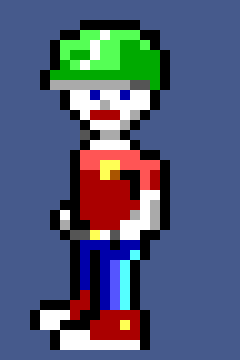 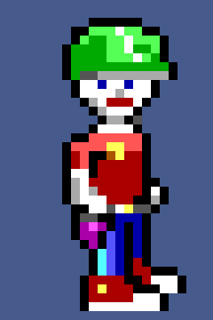 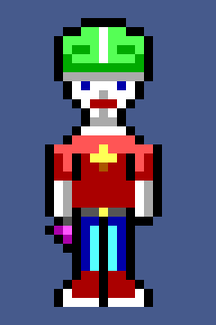

The first pass was built from an older 24 × 32 sprite set by mistake. [`older-and-newer-sprites-compared.png`](01-reference/older-and-newer-sprites-compared.png) shows the difference that had to be corrected: the newer Ben is leaner and taller, with a close-fitting striped helmet, a T-shirt with bare forearms, a belt, a holstered Stunner and high-top runners. The pose workshop's own sprite sets ([stand to fire](01-reference/workshop-sprites-stand-run-pogo-fire.png), [climb to idle](01-reference/workshop-sprites-climb-jump-fall-idle.png)) then became the reference for every pose, using only its newest sections.

**Learned:** read the newest art, and ask which art is newest.

## 2 · Round one: A, B and C

Three directions on a turntable, built from simple shapes: **A · Pixel-true** (the sprite inflated, exact EGA colours, heavy ink line), **B · Lieutenant** (a leaner Saturday-morning hero with a comms aerial, scarf, chevrons and a backpack) and **C · Tinkerer** (low-poly, goggles, tool belt, knee pads).

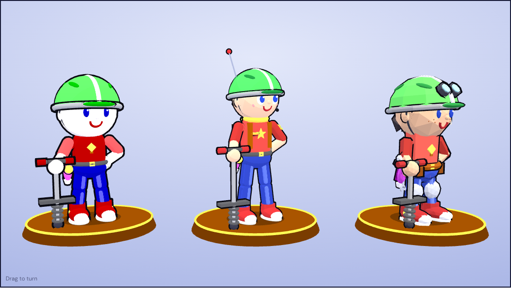

[`first-pass-from-the-older-sprites.png`](02-round-one-a-b-c/first-pass-from-the-older-sprites.png) is the version built from the wrong sprites, with A as a big-helmeted toy. The other images, and [`round-one.html`](02-round-one-a-b-c/round-one.html), are the corrected round.

**What came back:** no round head and no bulb head. He is a normal kid who goes on adventures. Cartoony is fine, and so is more lifelike.

## 3 · Round two: D, E and F

Three new builds on a jointed skeleton, with eleven poses taken from the workshop's sprite sets and dials to pose him by hand: **D · Workshop cut** (the workshop's own measurements, exact EGA colours), **E · Saturday serial** (a cartoon kid with natural skin, eyebrows and a fringe) and **F · Kid next door** (lifelike proportions, soft materials, no ink line).

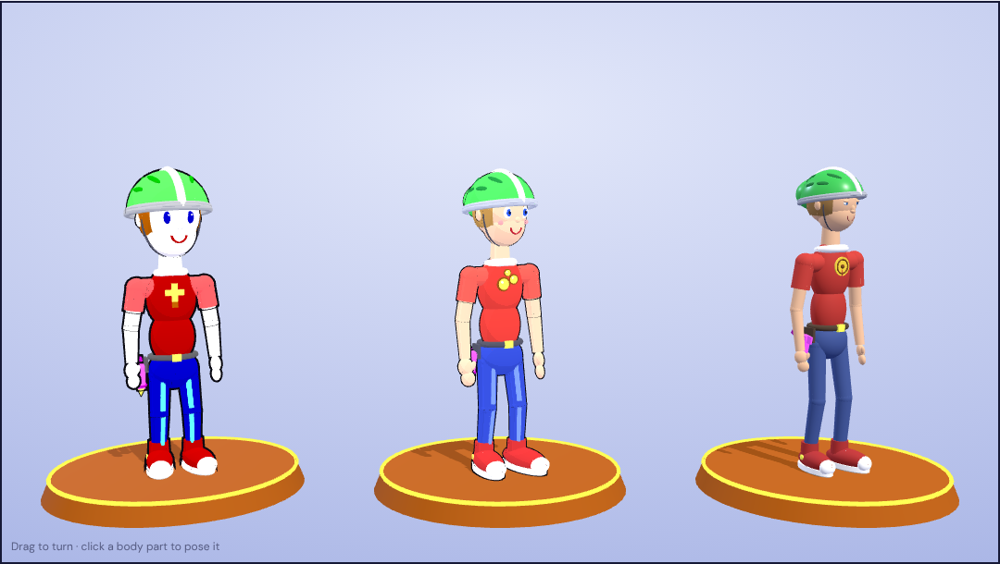

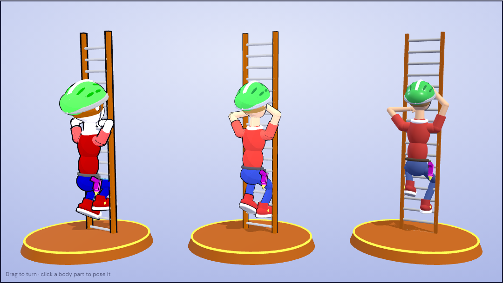

**What came back:** the cartoon style is the one. E's face and motion are right, B's size is right for the sprite, and the neck is too long. The joints read as bulges rather than a body: he is "not one unit". He also needs cartoon hands with a thumb and three fingers, and no gloves.

## 4 · Round three: G, H and I

The body became one continuous skinned surface, so shoulders, elbows, waist and knees bend instead of hinging. All three took E's face on B's sprite-sized build with a shorter neck: **G · Sprite size** (nothing added), **H · Lieutenant** (B's gear on the new body) and **I · Scrapes and all** (lankier, freckled, plasters).

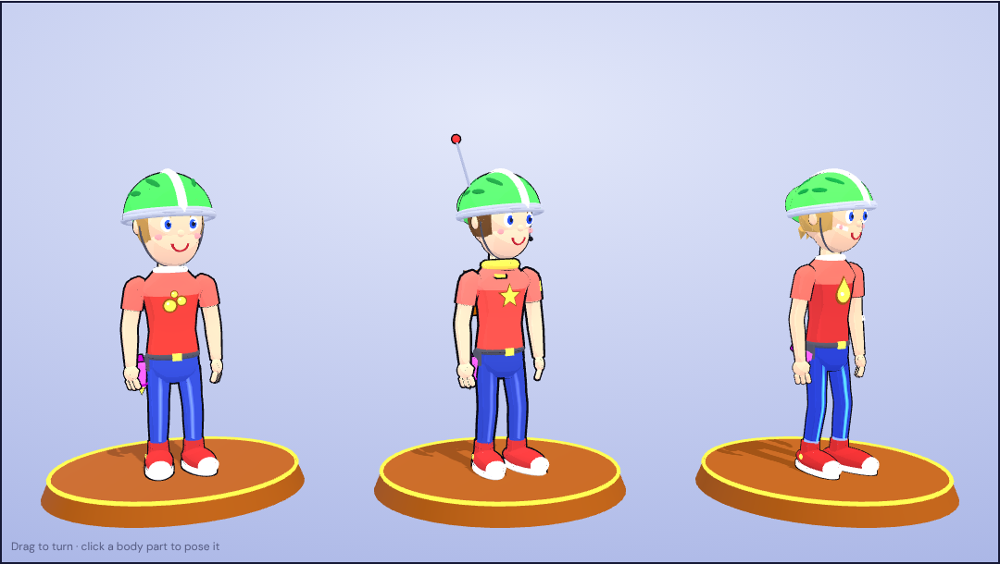

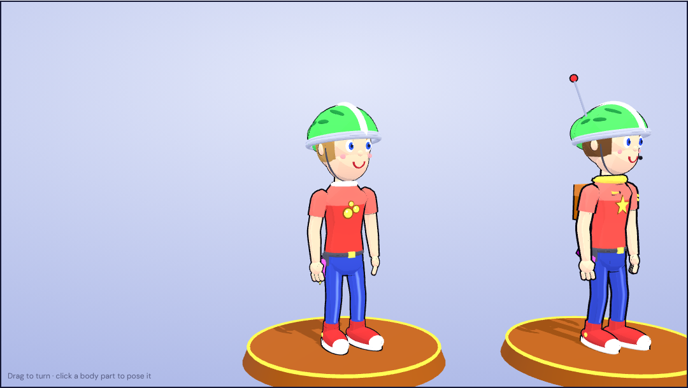

**What came back:** G. "That's the Ben."

## 5 · The tuning bench

G moved onto a bench with switches for everything still undecided, and the character sheet began. Answers arrived as the options were tried:

- **Locked:** he is 10; one red T-shirt whose white band is its own collar; jeans with a front stripe and side seams; no cheek marks; high-top runners a size and a half smaller; the ink line as an adjustable renderer setting.
- **The Fizz Stunner:** it fires the episode's fizz as a floating orb, cream soda in Episode 1 and grape in Episode 2. Of three designs, the [can loader](05-tuning-bench/option-stunner-can-loader.png) won, made round with the can loading into the back; the [pop bottle](05-tuning-bench/option-stunner-pop-bottle.png) was the runner-up and the [bubble dome](05-tuning-bench/option-stunner-bubble-dome.png) third.
- **New gear:** a wrist computer for his map, messages and AI helper, and an optional [backpack](05-tuning-bench/option-backpack.png) that carries the pogo stick.
- **The helmet:** a thicker shell, vents cut through it with his hair showing, and straps hung from the rim either side of each ear.

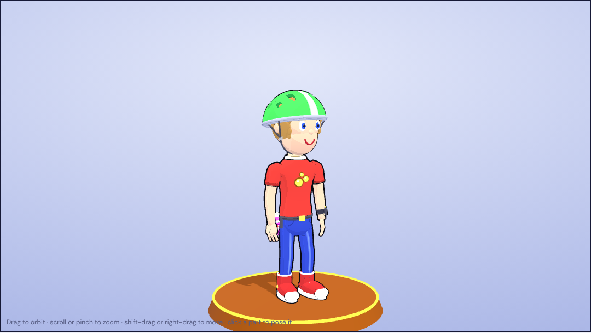 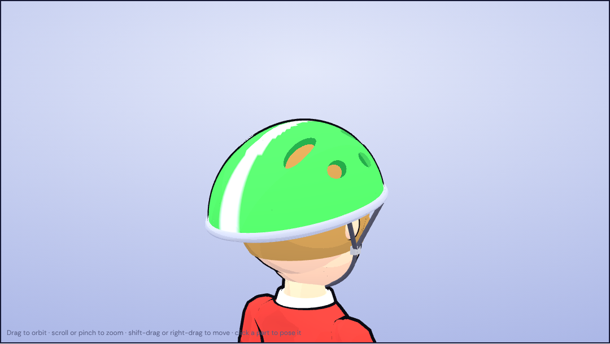

Most of the bench work was animation, corrected by looking at it: a hand through the helmet, a jump that never landed, a ledge pose with no climb, a pogo lean that was too dramatic, fizz that did not leave the Stunner on the trigger pull. Each note became a fix.

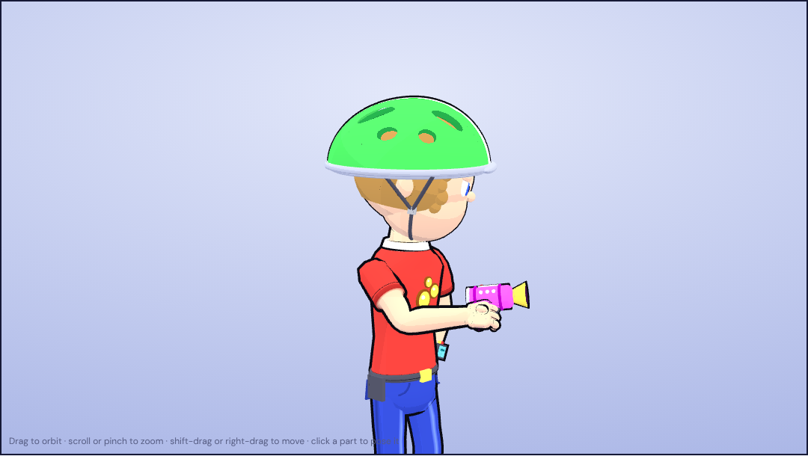 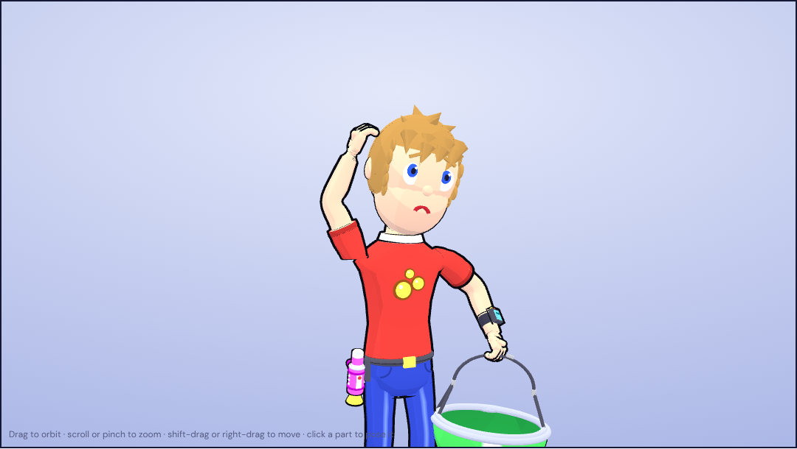

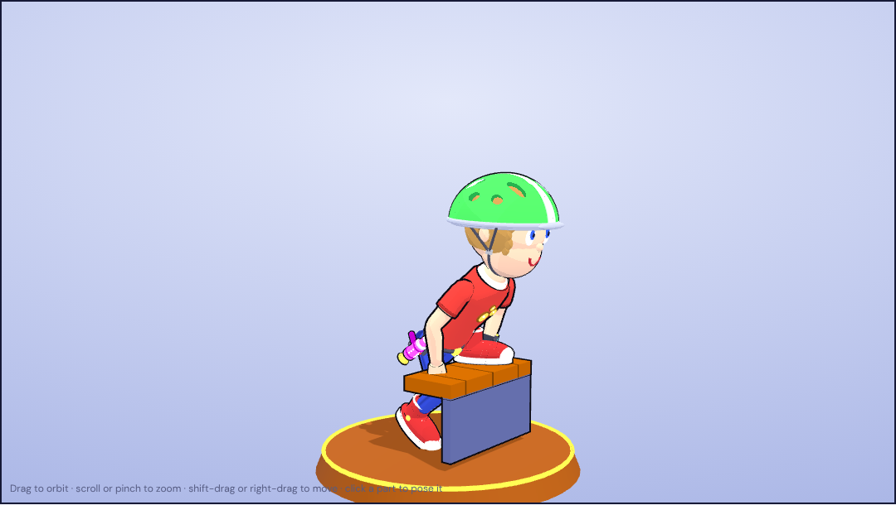 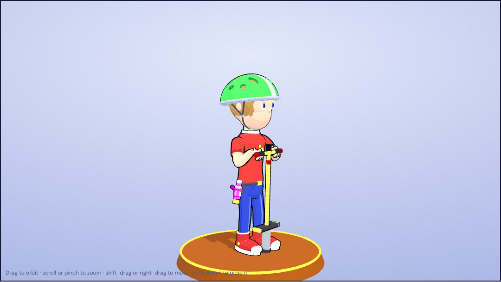

One correction came as data: the head-scratch arm was posed by hand on the bench, copied out as joint angles and pasted back, and the pose is built from those numbers.

**Learned:** a switch is a faster question than a paragraph, and a posable figure lets the art director fix a pose directly.

## 6 · Sprites of the new poses

Eight poses existed only on the model. Getting them back into sprites took four attempts:

1. A straight render through the workshop's sprite converter. It was too three-dimensional and too thin.
2. The same render mapped onto the hand-drawn proportions. Closer, but the hand-placed pixels that make the sprite Ben were gone.
3. The hand-drawn standing head stamped onto each helmeted frame.

   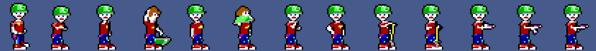

4. Four of the poses redrawn by the lab's own side-view sprite rig, from its hand-drawn head, shirt, arms, legs and shoes, then trimmed by hand: the shirt front came in by one pixel, then the chest by one more.

   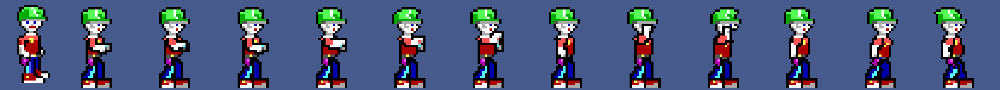

   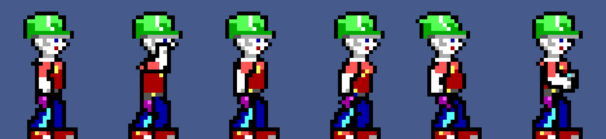

The first two attempts were overwritten as they were replaced, so no image of them survives. [`1-hand-drawn-reference.png`](06-sprites/1-hand-drawn-reference.png) is what they were measured against, [`5-lab-rig-idles-as-saved.png`](06-sprites/5-lab-rig-idles-as-saved.png) is the saved result, and [`6-still-model-renders.png`](06-sprites/6-still-model-renders.png) shows the four poses that still wait on art the skin lacks: a bare head, a held helmet, a hand-held pogo stick and a loose can.

**Learned:** a render cannot place a pixel the way a person does. The sprite's likeness lives in specific pixels, and a new pose keeps it only by reusing them.

## 7 · The exported model

The model left the page in three steps:

1. A rigged glTF binary with a seventeen-bone skeleton and a clip per pose. In a plain viewer it was smooth-shaded, with no outline.

   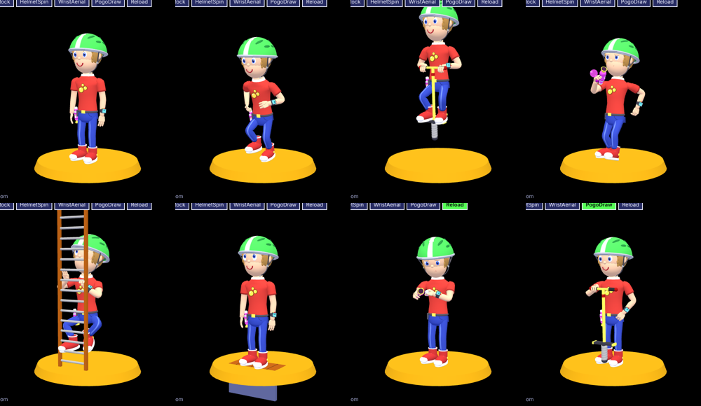

2. A cartoon viewer that restores the toon shading and ink line and renders high-resolution stills.

   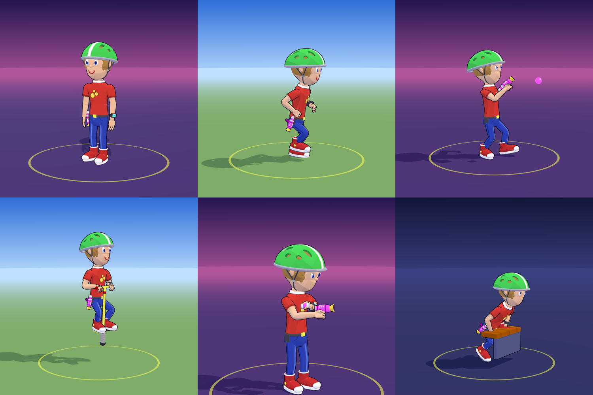

3. A second file with the cartoon baked in: unlit colours with a painted shadow tone and a black shell for the ink line, so it looks the same anywhere. The first five frames below are that file in a bare viewer with no lights; the last is the lit file in the same viewer.

   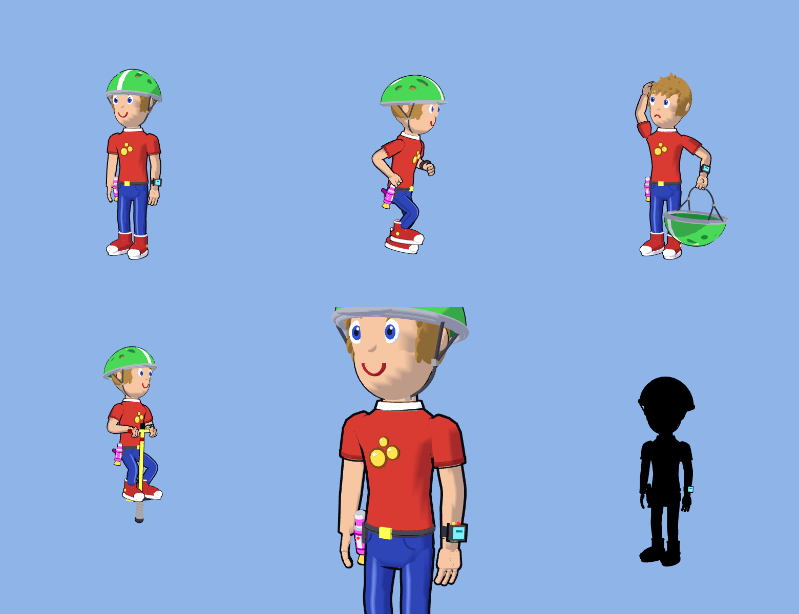

The full-size stills are in [`models/ben-g/renders`](../../models/ben-g/renders/), and [`models/ben-g/README.md`](../../models/ben-g/README.md) explains the two files.

**Learned:** a look that lives in a shader stays in the viewer. To travel, it has to be in the file.

## What the samples are

The pages in folders 2 to 4 are the rounds as they were shown, kept for the record; they load Three.js from a CDN and open straight from disk. Their screenshots and those of the tuning bench were retaken together from those pages, so they share one framing. The images in folders 6 and 7 are the working images from the time.
