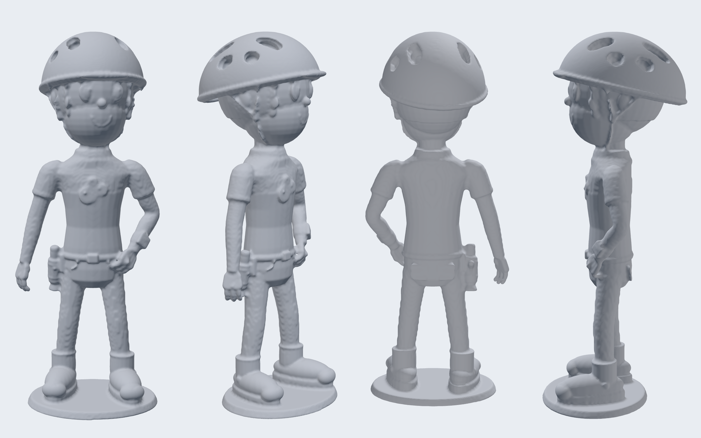
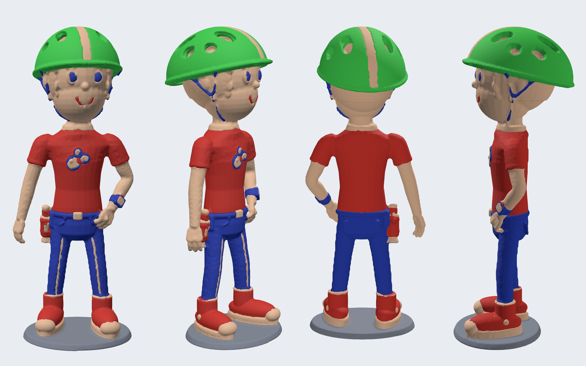
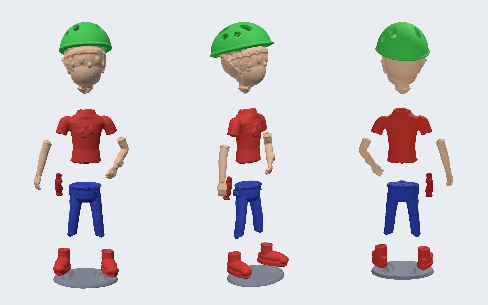

# Ben Blaze · printable models

Three versions of the cartoon Ben for a 3D printer, built by `bun run model:print-g` from the model in `src/model-3d/ben-g/`. All are in millimetres with Z up: he stands 120 mm tall on a 3 mm base, about 48 mm wide and deep. Every body in every file is a closed, outward-facing surface.

| File | Printer | What is inside |
|---|---|---|
| `ben-g-solid.stl` | Any, one colour | Ben and his base as a single solid. |
| `ben-g-four-colour.3mf` | A multi-material printer (AMS, MMU, tool changer) | One model in five parts that fit together exactly: helmet green, shirt red, jeans blue, skin and white, and the base. |
| `ben-g-kit.3mf` | Any, one colour at a time | Ten separate pieces in their assembled positions, each to print in one filament, with holes for alignment pins. |







## The pose

He stands with his feet apart, his left fist on his hip, his right arm loose beside the holstered Stunner and his chin up. Gaps narrower than about 1.5 mm are closed so nothing is left hanging by a thread: the helmet is packed solid onto his head, with the vents left as pits. The surface is the model's own; his body shows the model's facets faintly.

## One solid

Print it upright on its base. The chin, helmet rim, hands and Stunner overhang and need supports; tree supports touching the build plate only are enough.

## Four colours

The four filaments are helmet green, shirt red, jeans blue and a skin tone. The model has more colours than that, so the rest share them:

| Filament | Also prints |
|---|---|
| Green | The helmet's rim and peak |
| Red | Runners, mouth, the Stunner |
| Blue | Eyes, brows, chin strap, belt, wrist computer, badge rims |
| Skin | Everything white or light: the helmet stripe, shirt collar, jeans stripes, soles and toe caps, belt buckle, badge bubbles, and his hair |

The base is a fifth part so it can take any of the four. Open the file as one object with several parts, then give each part its filament: the parts carry their names and colours, but the file does not assign extruders, because each slicer stores that differently.

## The kit

| Filament | Pieces |
|---|---|
| Green | `helmet` |
| Skin | `head`, `arm-left`, `arm-right` |
| Red | `shirt`, `runner-left`, `runner-right`, `stunner` |
| Blue | `jeans` |
| Any | `base` |

The small details (eyes, belt, badge, stripes) are relief on the piece they sit on, to paint or leave. The pieces divide where the colours change, so most joins are flat or gently curved faces that print well face down. Split the file into its objects in the slicer and turn each piece onto its best face.

Nine joins have a 2 mm hole on each side for a pin cut from 1.75 mm filament: base to each runner, each runner to the jeans, jeans to shirt, each arm to the shirt, shirt to head, and head to helmet. The holes run up to 4 mm into each piece, less where the piece is thin, so cut each pin a little shorter than its two holes together (the build prints each length). The Stunner glues to his right hip without a pin.

## Other sizes

```bash
bun run model:print-g -- --height 180 --voxel 0.4   # a taller Ben on a coarser grid
bun run model:print-g -- --stl                      # also write each colour and kit piece as its own STL in stl/
```

`--height` is his height in millimetres without the base and `--voxel` the size of the grid the solid is formed on; 0.3 mm takes about a minute. Scaling the files in a slicer works too, but the pin holes scale with them. The separate STLs are not committed.

## How it is made

The animated model is many overlapping, open surfaces, which a slicer cannot print. `scripts/print-solid.ts` samples every surface of the posed model onto a voxel grid, floods the grid from outside with a small ball, and keeps everything the ball cannot reach, which fuses the parts and fills the hollows. Near the surface the depth is measured to the model's own triangles, so the solid follows the model rather than the grid. Each voxel then takes the colour of the nearest visible surface, and each colour is meshed so that neighbouring bodies share their boundary.

## Not yet tried

None of the three files has been opened in a slicer or printed. They were checked for closed surfaces with a second library and inspected in renders.
